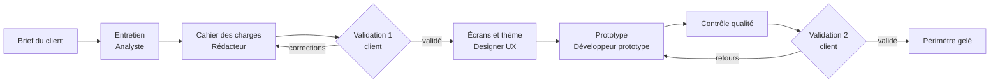

# Architecture

## Parcours d'un projet

Les étapes et les transitions autorisées sont définies dans `packages/core/src/workflow.ts`. Seul l'Orchestrateur les applique, et les deux validations viennent toujours du client.

## Agents

| Agent | État | Rôle |
| --- | --- | --- |
| Orchestrateur | Lot 1 | Fait avancer le projet, déclenche les agents, publie les événements |
| Analyste fonctionnel | Lot 1 | Mène l'entretien, au plus 3 questions par message |
| Rédacteur de spécifications | Lot 1 | Produit le cahier des charges et le backlog (sortie structurée) |
| Designer UX | Lot 2 | Écrans, navigation, thème |
| Développeur prototype | Lot 2 | Code front React (web) ou Expo (mobile) avec données simulées |
| Contrôleur qualité | Lot 2 | Couverture des user stories, lancement du prototype |

L'Analyste et le Rédacteur font chacun un appel à l'API Claude (`claude-opus-5-5`) avec sortie structurée validée par Zod ; ils n'ont pas besoin d'outils. Le Développeur prototype, qui écrit des fichiers et lance des commandes, s'appuiera sur le Claude Agent SDK dans un conteneur isolé par projet.

Chaque appel à un agent passe par `Orchestrator.task()` : l'agent est marqué actif, un événement de début puis de fin est publié, et une erreur bloque le projet avec sa raison au lieu de le laisser dans un état incohérent.

## Suivi en temps réel

Chaque écriture dans le `Store` est notifiée. L'API expose ces notifications en Server-Sent Events (`/api/stream`, filtrable par projet). L'interface relit l'instantané du projet à chaque notification.

Avec Supabase, le même rôle sera tenu par Supabase Realtime : les quatre tables sont déjà ajoutées à la publication `supabase_realtime` dans la migration.

## Données

`InMemoryStore` sert au mode démo et aux tests. La migration `supabase/migrations/20261123000000_init.sql` décrit le schéma cible, avec sécurité par ligne : un client ne lit que ses projets, et les agents écrivent avec la clé service.

## Suite prévue

1. `SupabaseStore` et authentification des clients.
2. File de tâches (pg-boss) pour que le travail des agents survive à un redémarrage.
3. Lot 2 : Designer UX, Développeur prototype, conteneur d'exécution, prévisualisation et revue avec commentaires par écran.
